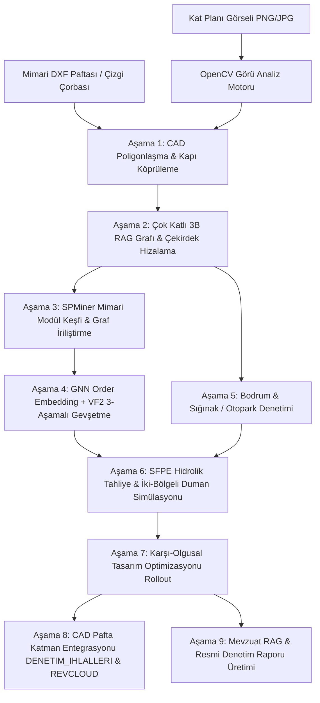

# DiagramYönetmelik — Nöro-Sembolik 3B Yangın & İmar Mevzuat Denetimi

[](LICENSE)
[](https://www.python.org/)
[](https://threejs.org/)
[](https://pyg.org/)
[](https://fastapi.tiangolo.com/)

> **DiagramYönetmelik**, çok katlı mimari CAD paftaları (DXF) ve raster kat planı görselleri üzerinde yangın güvenliği ve imar mevzuatını (BYKHY 2007/2015, PAİY, Sığınak ve Otopark Yönetmelikleri) 3B uzaysal RAG grafı, GNN order embedding, açıklanabilir VF2 alt-graf monomorfizmi, SFPE hidrolik tahliye simülasyonu ve karşı-olgusal (counterfactual) optimizasyon ile denetleyen otonom bir nöro-sembolik mimari zeka platformudur.

---

## 🏛️ Mimari ve 9 Aşamalı Denetim Akışı



---

## 🚀 Öne Çıkan Özellikler

1. **CAD & Çizgi Çorbası Poligonlaştırma (Line Soup Ingest)**:
   - Açık kapı boşluklarını otomatik tespit eden ve köprüleyen tamponlama algoritması.
   - 20 cm duvar kalınlıklarını morfolojik aşındırma ile odalara dönüştüren uzaysal geometri motoru.
   - 100+ Türkçe mimari kısaltma ve oda etiketini 11 standart fonksiyona (`oda`, `kat_koridoru`, `yangin_holu`, `yangin_merdiveni`, `dis_cikis`, `siginak`, `otopark`, vb.) eşleyen kural tabanlı sınıflandırıcı.

2. **Çok Katlı 3B RAG Grafı (Multi-Floor 3D Spatial RAG)**:
   - Katlar arası düşey çekirdekleri (merdivenler, asansörler) centroid çakışması ve dikey şaft bağlantıları ile bağlayan 3B graf.
   - **2.2× Merdiven Direnci Faktörü**: Düşey kaçışta merdiven basamaklarının koridor yürüyüşüne göre 2.2 kat fazla efor ve süre gereksinimini hesaba katan ağırlıklı mesafe matrisi.
   - **Yangın Asansörü Kısıtı**: BYKHY Madde 62 gereği normal ve yangın asansörlerini tahliye graflarından hariç tutma.

3. **SPMiner Modül Keşfi & Graf İriliştirme**:
   - Tekrarlayan mimari motifleri (2+1, 3+1 daire çekirdekleri, hol-merdiven dizilimleri) açgözlü büyüme ve WL-hash ile tespit eder.
   - Büyük binaları makro-düğümlere (macro-nodes) indirgerken en derin odadan daire kapısına olan iç kaçış derinliğini (`internal_exit_depth_m`) matematiksel olarak korur.

4. **GNN Order Embedding + Açıklanabilir VF2 Yangın Denetimi**:
   - **1-WL Kırıcı Rastgele Yürüyüş Konumsal Kodlamaları (RWPE)**: $C_6$ halka koridor ile $2 \times C_3$ üçgen mekan döngülerini ayırt eder.
   - Kısmi sıralı koni gömmesi (Order Embedding Loss) ile mevzuat kural grafını mimari paftayla eşleştirir.
   - **3 Aşamalı VF2 Gevşetme Hunisi**:
     - *Aşama 1 (Parametrik)*: Kapı genişliği (< 1.20m), koridor kaçış mesafesi (> 15m/30m).
     - *Aşama 2 (Rol/Etiket)*: Mekan fonksiyonunun mevzuatla uyuşmazlığı.
     - *Aşama 3 (Topolojik Eksiklik)*: Yangın holünün veya kaçış merdiveninin doğrudan bulunmaması.

5. **Bodrum, Sığınak ve Otopark Uyumluluk Denetimi**:
   - **Sığınak Yönetmeliği (Madde 9, 13)**: Sığınak girişinde min 1.5 m² alanlı ve sızdırmaz çift kapılı hava kilidi (airlock) varlık kontrolü.
   - **Otopark Yönetmeliği & BYKHY (Madde 60)**: Kapalı otopark alanından yangın merdivenine / asansör holüne doğrudan kapı açılması yasağı denetimi.

6. **SFPE Hidrolik Tahliye & İki-Bölgeli Duman Simülasyonu**:
   - Zaman adımı $\Delta t = 0.5\text{ s}$ olan hücre iletim modeli (Cell Transmission Model).
   - Kapı genişliği ve basamak eğimine bağlı akış kapasitesi ($1.17$ kişi/m·s) ve geriye yayılımlı (spillback) kuyruklaşma simülasyonu.
   - **İki-Bölgeli Duman Katmanı Çöküşü ($Z_{\text{layer}}(t)$)**: Yangın kaynağında sıcak duman tabakasının inişi, kritik tenability yüksekliği ($1.80\text{ m}$) ve ASET (Kullanılabilir Güvenli Tahliye Süresi) vs RSET (Gereken Tahliye Süresi) güvenlik marjı hesabı.

7. **Karşı-Olgusal (Counterfactual) Tasarım Optimizasyonu**:
   - En büyük darboğazdan başlayarak aşağı akış yönünde kapı genişletme ($0.90\text{ m} \to 1.20\text{ m}$), kapı açılış yönü düzeltme ve hava kilidi ekleme rollout'u.
   - Geriye doğru gereksiz müdahaleleri budayarak minimum maliyetle (TL) maksimum süre kazancı (-18.5s) elde etme.

8. **2B CAD DXF Pafta & Revcloud Katman Entegrasyonu**:
   - `DENETIM_IHLALLERI` (Kırmızı ACI 1, MTEXT lider çizgileri, hedef kutuları).
   - `OPTIMIZASYON_ONERILERI` (Yeşil ACI 3, native AutoCAD 0.55 yay bombeli REVCLOUD revizyon bulutları).
   - Pafta antetine işlenen `DENETIM_OZET_TABLOSU`.

9. **Ultra-Modern 3B WebGL / Three.js Arayüzü**:
   - 4 Kamera Ön-ayarı (3B İzometrik, 2B Plan, Yan Kesit Çekirdek, 1. Şahıs Kaçış Görünümü).
   - Kat izolasyonu (`Tümü`, `K1`, `Zemin`, `K-1`) ve inaktif katlarda %10 opaklıkta Ghost Wireframe.
   - Patlatılmış Z ekseni aralığı ($1.0\times$ - $3.0\times$) slider'ı.
   - Duvar yüksekliği modları (Tam 2.8m, Mimari Kesit 1.1m, Döşeme 0.1m).
   - Canlı duman inişi ve darboğaz ısı haritası görselleştirmesi.
   - 0 - 180 saniye simülasyon zaman çubuğu, hızlandırıcılar ($1\times, 2\times, 5\times$) ve oynatıcı.
   - Önce / Sonra karşılaştırma görünümü (`DENETIM_IHLALLERI` kırmızı vs `OPTIMIZASYON_ONERILERI` yeşil).

---

## 📦 Kurulum ve Çalıştırma

### 1. Gereksinimler
- Python 3.10+
- Node.js v18+ ve npm
- PyTorch 2.0+ ve PyTorch Geometric

### 2. Python Ortamı Kurulumu
```bash
# Bağımlılıkları yükleyin
pip install torch torch-geometric ezdxf shapely opencv-python networkx fastapi uvicorn pytest
```

### 3. Testleri Çalıştırma
```bash
python -m pytest -v tests/test_diagram_yonetmelik.py
```
*(11/11 birim ve entegrasyon testi %100 başarıyla geçer.)*

### 4. Frontend Derleme & Sunucu Başlatma
```bash
# Frontend paketlerini kurun ve derleyin
cd frontend
npm install
npm run build
cd ..

# FastAPI sunucusunu başlatın
python -m uvicorn diagram_yonetmelik.api:app --host 127.0.0.1 --port 8790
```

Tarayıcınızda açın:
👉 **`http://127.0.0.1:8790/`**

---

## 📑 Dizin Yapısı

```
c:\Users\seydieryilmaz\Desktop\gemini_yangın_imari\
├── diagram_yonetmelik/              # Modüler Python Motoru
│   ├── __init__.py                  # Paket dışa aktarımları
│   ├── schemas.py                   # Pydantic ve veri kontratları
│   ├── cad_ingest.py                # DXF çizgi çorbası ve Türkçe etiket sınıflandırıcı
│   ├── cv_analyzer.py               # OpenCV kat planı analiz motoru
│   ├── spatial_rag.py               # Çok katlı 3B mekânsal RAG ve düşey çekirdekler
│   ├── gnn_order.py                 # 1-WL RWPE ve koni gömmesi (SpatialOrderGNN)
│   ├── spminer.py                   # SPMiner modül keşfi ve graf iriliştirme
│   ├── vf2_diagnostics.py           # Açıklanabilir VF2 3-aşamalı gevşetme hunisi
│   ├── basement_audit.py            # Sığınak hava kilidi ve otopark merdiven denetimi
│   ├── evacuation.py                # SFPE hidrolik tahliye ve karşı-olgusal optimizasyon
│   ├── dxf_annotator.py             # Kırmızı/Yeşil DXF katmanları ve REVCLOUD
│   ├── regulatory_rag.py            # BYKHY, PAİY mevzuat RAG ve resmi rapor
│   ├── sample_generator.py          # Örnek 3 katlı konut DXF ve PNG üreticisi
│   ├── orchestrator.py              # 9 aşamalı tam pipeline yürütücüsü
│   └── api.py                       # FastAPI REST API ve statik dosya sunucusu
├── frontend/                        # 3B WebGL React + Three.js Arayüzü
│   ├── src/
│   │   ├── components/
│   │   │   ├── Header.tsx           # Üst bar ve 9 aşamalı durum şeridi
│   │   │   ├── ThreeScene.tsx       # Three.js 3B bina ve simülasyon sahnesi
│   │   │   ├── TimelineControls.tsx # 0-180s zaman çubuğu, kamera ve kat kontrolleri
│   │   │   ├── SidebarTabs.tsx      # 11 çalışma masası sekmesi
│   │   │   ├── DetailsDrawer.tsx    # 3B nesne ve ihlal inceleme çekmecesi
│   │   │   └── Panels/              # Sekme panelleri (Overview, Fire, Evac, vb.)
│   │   ├── index.css                # Siber-mühendislik karanlık cam tasarımı
│   │   └── App.tsx                  # Ana React uygulama bileşeni
│   ├── package.json
│   └── vite.config.ts
├── tests/
│   └── test_diagram_yonetmelik.py   # Kapsamlı test paketi (11 test)
├── LICENSE                          # Özel Lisans — Tüm Hakları Saklıdır
└── README.md
```

---

## 📜 Lisans

```
ÖZEL LİSANS — TÜM HAKLAR SAKLIDIR

Telif Hakkı (c) 2026 Seydi Eryılmaz (@seydivakkas)

Bu yazılım ve ilgili tüm dosyalar ("Yazılım") yalnızca görüntüleme ve eğitim
amaçlı olarak paylaşılmıştır.

YASAKLAR:
  1. Kopyalanamaz, çoğaltılamaz, dağıtılamaz veya yeniden yayınlanamaz.
  2. Ticari veya ticari olmayan hiçbir projede kullanılamaz, değiştirilemez.
  3. Alt lisanslanamaz, satılamaz veya devredilemez.
  4. Tersine mühendislik yapılamaz.

İZİN VERİLEN KULLANIM:
  - GitHub üzerinde görüntüleme ve okuma.
  - Kişisel öğrenim amacıyla kodu inceleme (kopyalamadan).

YAZARIN AÇIK YAZILI İZNİ OLMAKSIZIN HİÇBİR KULLANIM HAKKI TANINMAZ.
İzin talepleri için: GitHub @seydivakkas
```
