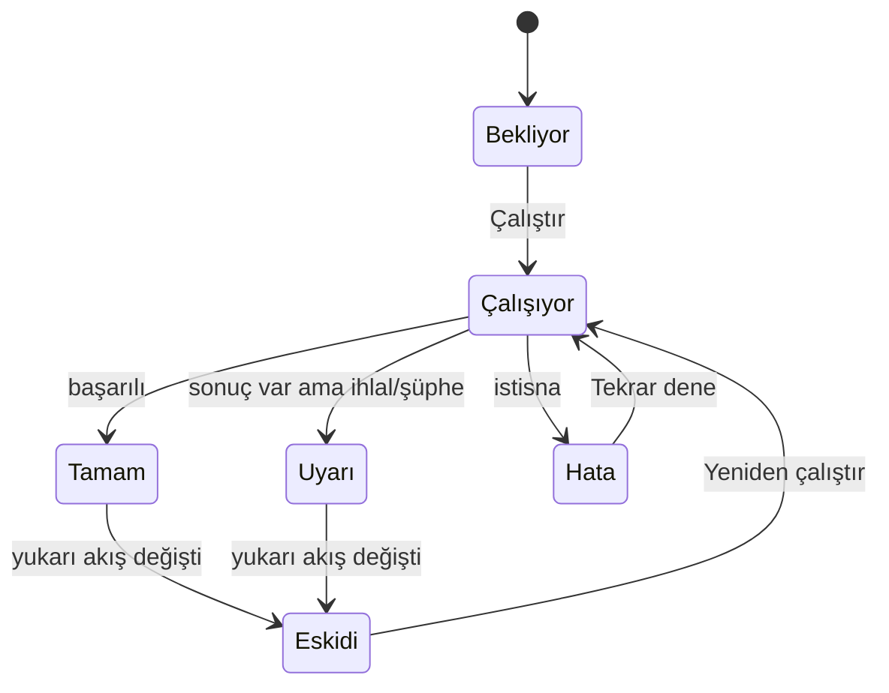
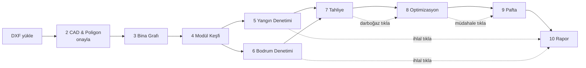

# MimarLLM — Arayüz ve Sayfa Tasarımı (v0.1)

> Kaynak: `proje_tamamı_bu_.txt`. Arayüz, `MimarLLMCompliancePipeline` içindeki **9 aşamalı akışı** ve `grounded_evidence_json` / `audit_trail.json` çıktısını kullanıcıya gösterecek şekilde kurgulanmıştır.
> Örnek sayılar (28 oda, 26 kapı, 76.5 sn → 58.0 sn vb.) dosyadaki uçtan uca örnekten alınmıştır ve wireframe'lerde sahte veri olarak kullanılır.

---

## 1. Amaç ve kullanıcı rolleri

| Rol | Ne yapmak ister | Ağırlıklı kullandığı sekmeler |
|---|---|---|
| **Mimar** | DXF yükler, ihlalleri görür, öneriyi kabul/ret eder | Pafta, Yangın, Optimizasyon |
| **Denetçi / Kontrol mühendisi** | İhlalin hangi yönetmelik maddesine dayandığını doğrular | Mevzuat & Rapor, Denetim İzi |
| **Yangın / tahliye danışmanı** | Tahliye süresi, darboğaz, spillback analizi | Tahliye, Optimizasyon |
| **Geliştirici / ML mühendisi** | GNN, VF2, SPMiner çıktılarını ayıklar | Modül Keşfi, Model & Ayarlar, Ham JSON |

**Tasarım ilkesi:** Arayüz bir *sihirbaz* değil, bir *çalışma masası*dır. Pipeline soldan sağa akar ama kullanıcı tamamlanmış herhangi bir sekmeye serbestçe geri dönebilir.

---

## 2. Bilgi mimarisi (site haritası)

```
MimarLLM
├── 0. Projeler (giriş / liste)
│
└── Proje Çalışma Alanı
    ├── 1. Genel Bakış (Dashboard)
    ├── 2. CAD & Poligon             ← Aşama 1
    ├── 3. Bina Grafı (3B RAG)       ← Aşama 2
    ├── 4. Modül Keşfi (SPMiner)     ← Aşama 3
    ├── 5. Yangın Denetimi (GNN+VF2) ← Aşama 4
    ├── 6. Bodrum Denetimi           ← Aşama 5
    ├── 7. Tahliye Simülasyonu       ← Aşama 6
    ├── 8. Optimizasyon              ← Aşama 7
    ├── 9. Pafta Önizleme (DXF)      ← Aşama 8
    ├── 10. Mevzuat & Rapor          ← Aşama 9
    └── ⚙ Ayarlar
        ├── Şablon Kütüphanesi (sorgu şablonları)
        ├── Model & Eşikler
        ├── Mevzuat İndeksi
        └── Ham JSON / Geliştirici
```

Sekme numaraları pipeline aşamalarıyla bire bir eşleşir. Dashboard ve Ayarlar pipeline dışıdır.

---

## 3. Genel kabuk (Shell) düzeni

Tüm proje sayfalarında sabit kalan çerçeve:

```
┌──────────────────────────────────────────────────────────────────────────┐
│ ☰  MimarLLM  /  Proje: Atakent Konut A Blok   [v3 ▾]    🔍  ⟳ Çalıştır  👤│  ← Üst bar
├────────┬─────────────────────────────────────────────────────┬───────────┤
│        │  [Aşama durum şeridi: ①✓ ②✓ ③✓ ④✓ ⑤✓ ⑥✓ ⑦✓ ⑧✓ ⑨✓]   │           │
│ SOL    ├─────────────────────────────────────────────────────┤  SAĞ      │
│ SEKME  │                                                     │  DETAY    │
│ ÇUBUĞU │                  ANA İÇERİK ALANI                   │  PANELİ   │
│        │          (harita / graf / tablo / rapor)            │ (seçili   │
│ 1 Genel│                                                     │  nesne)   │
│ 2 CAD  │                                                     │           │
│ 3 Graf │                                                     │           │
│ 4 Modül│                                                     │           │
│ 5 Yangın                                                     │           │
│ 6 Bodrum                                                     │           │
│ 7 Tahliye                                                    │           │
│ 8 Optim.                                                     │           │
│ 9 Pafta│                                                     │           │
│10 Rapor│                                                     │           │
├────────┴─────────────────────────────────────────────────────┴───────────┤
│ Durum: Hazır │ 28 oda · 26 kapı · 3 kat adası │ Son çalıştırma 14:32 │ 🐞 │  ← Alt durum çubuğu
└──────────────────────────────────────────────────────────────────────────┘
```

### 3.1 Bileşenler

| Bölge | İçerik | Davranış |
|---|---|---|
| **Üst bar** | Proje adı, sürüm seçici, global arama (oda/kapı/ihlal kodu), **Çalıştır** düğmesi, kullanıcı menüsü | Çalıştır: tüm pipeline'ı veya seçili aşamadan itibaren yeniden koşturur |
| **Sol sekme çubuğu** | 10 sekme, her birinde durum rozeti (⏳ bekliyor, ⟳ çalışıyor, ✓ tamam, ⚠ uyarı, ✗ hata) ve ihlal sayısı rozeti | Daraltılabilir (yalnızca ikon); klavye: `Alt+1…9` |
| **Aşama durum şeridi** | 9 aşamanın yatay ilerleme çubuğu | Tıklanabilir; ilgili sekmeye gider |
| **Ana içerik** | Sekmeye özel | Aşağıda her sekme için ayrıntı |
| **Sağ detay paneli** | Seçili oda/kapı/ihlal/modül özellikleri | Varsayılan kapalı; seçimde kayarak açılır; `Esc` ile kapanır |
| **Alt durum çubuğu** | Özet sayılar, son çalıştırma zamanı, log konsolu aç/kapa | Log, çalışırken canlı akar |

### 3.2 Global bağlam (tüm sekmelerde ortak)

- **Seçili nesne** (oda, kapı, ihlal, modül, müdahale) tek bir global durumda tutulur → bir sekmede seçilen nesne diğer sekmede otomatik vurgulanır.
- **Kat filtresi** (B2, B1, Zemin, 1…N, "Tümü") üst bardan her zaman değiştirilebilir.
- **Sürüm** (v1, v2, v3): her çalıştırma yeni bir sürüm üretir; sürümler arası karşılaştırma Dashboard'dan yapılır.

---

## 4. Sekmeler ve sayfa tasarımları

### 4.0 Projeler (giriş)

```
┌──────────────────────────────────────────────────────────┐
│ Projeler                          [+ Yeni Proje] [İçe aktar]│
├──────────────────────────────────────────────────────────┤
│ ┌────────────┐ ┌────────────┐ ┌────────────┐            │
│ │ Atakent A  │ │ Vadi Evleri│ │ + Yeni     │            │
│ │ 3 sürüm    │ │ 1 sürüm    │ │            │            │
│ │ ⚠ 7 ihlal  │ │ ✓ temiz    │ │            │            │
│ └────────────┘ └────────────┘ └────────────┘            │
└──────────────────────────────────────────────────────────┘
```

**Yeni proje akışı:** DXF sürükle-bırak → birim/ölçek onayı → "Analizi başlat" → doğrudan **Genel Bakış**'a düşer.

---

### 4.1 Genel Bakış (Dashboard)

**Amaç:** 10 saniyede "bu proje uygun mu, ne yapmalıyım?" sorusunu yanıtlamak.

```
┌────────────────────────────────────────────────────────────────────┐
│ KPI KARTLARI                                                       │
│ ┌────────┐ ┌────────┐ ┌────────────┐ ┌────────────┐ ┌───────────┐ │
│ │ 7 İHLAL│ │ 16 BB  │ │ 76.5→58.0sn│ │ 3→0 darboğ.│ │ 7 kırmızı │ │
│ │3 yangın│ │ standart│ │ −18.5 sn   │ │            │ │ 3 yeşil   │ │
│ │4 bodrum│ │ 1 tip  │ │            │ │            │ │ DXF işareti│ │
│ └────────┘ └────────┘ └────────────┘ └────────────┘ └───────────┘ │
├──────────────────────────────┬─────────────────────────────────────┤
│ İHLAL ÖZETİ (ciddiyete göre) │ KAT PLANI MİNİ HARİTA               │
│ ● ROOM_AREA_DEFICIT  (yangın)│  [kat seçici]                       │
│ ● DOOR_WIDTH_75<90   (yangın)│  kırmızı noktalar = ihlal konumu    │
│ ● PARKING_TO_STAIR   (bodrum)│                                     │
│ ...                [Tümünü gör]                                    │
├──────────────────────────────┴─────────────────────────────────────┤
│ SONRAKİ ADIM ÖNERİSİ:  "3 optimizasyon adımı onay bekliyor → [İncele]"│
└────────────────────────────────────────────────────────────────────┘
```

**Etkileşimler**
- KPI kartına tıklama → ilgili sekmeye geçiş (ihlal kartı → Yangın; tahliye kartı → Tahliye).
- İhlal satırına tıklama → Yangın/Bodrum sekmesinde ilgili ihlal seçili açılır + haritada zoom.
- Sürüm karşılaştırma: "v2 ile karşılaştır" → iki sürüm arası fark rozetleri (+/−).

---

### 4.2 CAD & Poligon (Aşama 1 — `cad_ingest.py`)

**Amaç:** Ham DXF'in doğru okunduğunu doğrulamak; poligon kurtarma gerekiyorsa sonucunu göstermek.

```
┌───────────────────────────────────────────────────────────────┬──────────┐
│ [Dosya: kat1.dxf]  Birim: cm ▾  Ölçek: 1:1 ✓   Mod: ◉Otomatik │ KATMANLAR│
│                                                  ○LWPOLYLINE   │ ☑ Duvar  │
│                                                  ○LINE Soup    │ ☑ Oda    │
├───────────────────────────────────────────────────────────────┤ ☑ Kapı   │
│                                                               │ ☑ Etiket │
│              2B HARİTA (pan/zoom)                             │ ☐ Sanal  │
│        oda poligonları renkli, kapılar yay ile                │   köprü  │
│        etiketler: SALON, YANGIN HOLÜ…                         │ ☐ Atılan │
│                                                               │   şerit  │
├───────────────────────────────────────────────────────────────┼──────────┤
│ Alt tablo sekmeleri:  [Odalar 28] [Kapılar 26] [Uyarılar 2]   │          │
│ id │ etiket        │ sınıf        │ alan m² │ güven          │          │
│ R01│ SALON         │ salon        │ 24.3    │ ●●●            │          │
│ R07│ HOL?          │ yangin_holu  │ 4.2     │ ●○○  ← düzelt  │          │
└───────────────────────────────────────────────────────────────┴──────────┘
```

**Önemli kontroller**
- **Kurtarma raporu kartı:** "2 cm açık köşe kenetlendi · 3 kapı boşluğu sanal köprüyle kapatıldı · 12 duvar-içi şerit elendi".
- **Etiket sınıflandırıcı düzeltme:** `TurkishArchitecturalLabelClassifier` düşük güvenle sınıflandırdıysa satır sarı; kullanıcı açılır listeden oda tipini değiştirir → "Yeniden çalıştır" gerekir (aşağı akış sekmeleri ⚠ "eskidi" rozeti alır).
- **Onay kapısı:** Birim/ölçek ve oda tipleri onaylanmadan Aşama 2 başlamaz (düğme: **"Doğru, grafı kur →"**).

---

### 4.3 Bina Grafı (3B RAG, Aşama 2 — `spatial_graph.py`)

**Amaç:** `G_3d` yapısını görsel olarak doğrulamak: kat adaları, dikey şaftlar, yangın kullanılabilirliği.

```
┌──────────────────────────────────────────────────────────┬───────────────┐
│ Görünüm: ◉3B  ○2B kat  ○Şematik graf    Renk: [oda tipi▾]│ FİLTRE        │
├──────────────────────────────────────────────────────────┤ ☑ Kapı kenarı│
│                                                          │ ☑ Dikey şaft │
│        3B İZOMETRİK GRAF                                 │ ☑ Yangın     │
│        katlar üst üste, düğümler=oda, kenar=kapı         │   kullanılabilir│
│        dikey kenarlar: merdiven (düz), asansör (kesikli) │ ☐ Asansör    │
│        usable_in_fire=False kenarlar soluk gösterilir    │   (yangında  │
│                                                          │    pasif)    │
│                                                          │ Kat: [Tümü▾] │
├──────────────────────────────────────────────────────────┴───────────────┤
│ ÖZET:  3 kat adası · 4 dikey şaft · 28 düğüm · 26 kenar · çekirdek hizası: Δx=0│
└──────────────────────────────────────────────────────────────────────────┘
```

**Sağ panel (düğüm seçilince):** `room_type`, `area_m2`, `pos_3d`, `global_dxf_pos`, komşular, dereceler, "DXF'te göster" bağlantısı.

**Görünüm geçişleri:** 3B ↔ 2B ↔ şematik graf arasında kamera/seçim durumu korunur.

---

### 4.4 Modül Keşfi (SPMiner, Aşama 3)

**Amaç:** Tekrar eden daire/çekirdek modüllerini göstermek; sıkıştırmayı kontrol etmek.

```
┌───────────────────────────────────────────────────────────────────────┐
│ Tohum: ☑ Daire antresi  ☑ Kat koridoru  ☑ Yangın holü   Destek ≥ [4▾]  │
├──────────────────────────┬────────────────────────────────────────────┤
│ KEŞFEDİLEN MOTİFLER      │ SEÇİLİ MOTİF: M1 "2+1 Daire"               │
│ ▸ M1  2+1 Daire  ×16     │  ┌────────────────┐   Örnekler (16)         │
│   6 düğüm · WL:a3f9…     │  │ motif şeması   │   ▸ Kat1-D1  ▸ Kat1-D2  │
│ ▸ M2  Islak hacim ×16    │  │ (graf çizimi)  │   ▸ Kat2-D1 …           │
│   3 düğüm                │  └────────────────┘   [Haritada hepsini     │
│ ▸ M3  Kat holü   ×3      │  Toplam alan: 94.2 m²   göster]             │
│                          │  İç maks. kaçış: 11.8 m                      │
├──────────────────────────┴────────────────────────────────────────────┤
│ SIKIŞTIRMA   Önce: 28 düğüm  →  Sonra: 12 düğüm   [Sıkıştır] [Aç]     │
│ Çakışma çözümü: M1 seçildi (hacim skoru 96), M2 çakışıyor → atlandı    │
└───────────────────────────────────────────────────────────────────────┘
```

**Önemli davranışlar**
- **Örtüşen motifler** için açık uyarı: "M2, M1'in alt kümesi; çakışma nedeniyle sıkıştırmaya dahil edilmedi."
- **Sıkıştır / Aç** (`coarsen_building_graph` / `expand_macro_node`): geçiş animasyonlu; açıldığında düğüm/kenar sayısı kayıpsız geri gelir (test #4'ün görsel karşılığı).
- Makro düğüm tıklanınca `internal_max_escape_m`, `portal` kenarları sağ panelde.

---

### 4.5 Yangın Denetimi (GNN + VF2, Aşama 4)

**Amaç:** Sistemin en kritik sekmesi: hangi çekirdek uygun, hangisi neden elendi.

```
┌─────────────────────────────────────────────────────────────────────────┐
│ Şablon: [Yangın kaçış çekirdeği v2 ▾] [Düzenle]  Çapa: Yangın Güvenlik Holü│
│ Eşik (ihlal enerjisi): ──●───── 0.15     k-hop: 2                       │
├─────────────────────────────────────────────────────────────────────────┤
│ HUNİ ÖZETİ                                                              │
│  Tüm düğümler 28 ─▶ GNN adayı 6 ─▶ VF2 geçen 3 ─▶ Teşhis edilen 3        │
│  [████████████████░░░░░░░░░░]  arama uzayı %78.6 daraldı                │
├───────────────────────────────┬─────────────────────────────────────────┤
│ SONUÇLAR                      │ SEÇİLİ ADAY: #10   Aşama 1 · Parametrik │
│ ✓ #04 Uygun                   │ ┌─────────────────────────────────────┐ │
│ ✓ #07 Uygun                   │ │ Harita: aday altgraf vurgulu         │ │
│ ✓ #12 Uygun                   │ └─────────────────────────────────────┘ │
│ ⚠ #10 Aşama1 (4 kusur)        │ Bulgular:                               │
│ ⚠ #20 Aşama2 (rol)            │  ✗ Alan        4.2 m²  <  5.0 m²   −0.8 │
│ ⚠ #30 Aşama3 (eksik oda)      │  ✗ Yangın kapısı  yok  (EI60 şart)      │
│                               │  ✗ Kapı genişl. 75 cm  <  90 cm   −15 cm│
│ Filtre: [Tümü|Uygun|İhlalli]  │  ✗ Toplam rota 33 m   >  30 m     +3 m  │
│                               │ Madde: BYKHY md.34(1)   [Mevzuata git →]│
│                               │ [Optimizasyonda çöz →]  [DXF'te göster] │
└───────────────────────────────┴─────────────────────────────────────────┘
```

**Aşama rozet renkleri** (tutarlı kullanılır tüm uygulamada):

| Rozet | Anlam | Renk |
|---|---|---|
| ✓ Uygun | VF2 monomorfizm geçti | Yeşil |
| Aşama 1 | Parametrik kusur (kapı, alan, EI, mesafe) | Sarı |
| Aşama 2 | Oda rolü uyuşmazlığı | Turuncu |
| Aşama 3 | Kopuk kapı / eksik oda | Kırmızı |

**Etkileşimler**
- **Eşik kaydırıcısı:** Değiştirilince GNN adayları canlı güncellenir (yalnızca Aşama 4 yeniden koşar, hafif).
- **Şablon düzenleyici (modal):** Düğüm/kenar ekleme, "min kapı genişliği", "maks mesafe" gibi esnek kısıtlar. Kaydedilince Ayarlar › Şablon Kütüphanesi'ne yazılır.
- **Karşılaştır:** İki adayı yan yana göster (özellikle "iki yangın holü de aday" durumunda).
- **Simetri uyarısı:** Birden fazla eşleşme varsa "En az ihlalli eşleşme gösteriliyor (3 alternatif)" bağlantısı.

---

### 4.6 Bodrum Denetimi (Aşama 5 — `BasementComplianceAuditor`)

**Amaç:** Üst katlara bağlı dinamik kapasite ve yasaklı kenarları göstermek.

```
┌─────────────────────────────────────────────────────────────────────┐
│ GİRDİ (üst katlardan otomatik): 16 bağımsız bölüm · 1 520 m² brüt    │
│ → Sığınak ZORUNLU (≥12 BB)   → Gerekli net alan ≥ 16.0 m²            │
│ → Gerekli otopark ≥ 12 araç · engelli ≥ 1                            │
├──────────────────────────────┬──────────────────────────────────────┤
│ SIĞINAK                      │ OTOPARK                              │
│ Net alan  14.2 / 16.0 m² ✗   │ Araç adedi  14 / 12 ✓                │
│ Giriş: koridor→airlock→sığın │ Rampa genişliği 280 / 275 cm ✓       │
│        ✓ topoloji uygun      │ Rampa eğimi %18 / ≤%20 ✓             │
│ 2. çıkış  ✓                  │ Manevra koridoru 600 cm ✓            │
│ Kapı 90 cm · EI60 ✓          │ YASAKLI KENAR:                       │
│                              │  ✗ Kapalı otopark → Yangın merdiveni │
│                              │    (doğrudan kapı; EI60 holsüz)      │
├──────────────────────────────┴──────────────────────────────────────┤
│ [Şematik: kat_koridoru ─▶ siginak_holu ─▶ siginak ─▶ siginak_wc]     │
│  yasaklı kenar kırmızı kesikli çizgiyle                              │
└─────────────────────────────────────────────────────────────────────┘
```

Her satır "ölçülen / gerekli" biçiminde ilerleme çubuklu; ihlalli satıra tıklanınca hem bodrum haritasında vurgulama hem sağ panelde tr_siginak / tr_otopark maddesi açılır.

---

### 4.7 Tahliye Simülasyonu (Aşama 6 — `Building3DEvacuationSimulator`)

**Amaç:** Tahliye süresini, darboğazları ve spillback'i zaman içinde izletmek.

```
┌──────────────────────────────────────────────────────────────────────┐
│ ▶ ⏸ ⏮  0.5 sn adım   Hız: 1x 2x 5x   Zaman: ──────●──── 52.0 / 76.5 sn│
├───────────────────────────────────────────┬──────────────────────────┤
│ 3B BİNA (hücre doluluğu ısı haritası)     │ ANLIK ÖLÇÜMLER           │
│  yeşil=boş → kırmızı=dolu                 │ Tahliye olan: 112 / 160  │
│  kenar kalınlığı = anlık debi             │ Spillback: ⚠ Kat1 sahanlık│
│  ● darboğaz işaretleri (sıra numaralı)    │ Çıkış debisi: 1.3 kişi/sn│
├───────────────────────────────────────────┴──────────────────────────┤
│ DARBOĞAZ SIRALAMASI                                                  │
│ #1 Merdiven-A / Kat1 sahanlık   şiddet 0.91   spillback 14.5 sn      │
│ #2 Kapı D-17 (75 cm)            şiddet 0.74                           │
│ #3 Kat2 yangın holü             şiddet 0.62                           │
│                                    [Optimizasyonu başlat →]          │
├──────────────────────────────────────────────────────────────────────┤
│ Grafik: zaman–kalan kişi eğrisi  (teorik min-cut sınırı kesik çizgi) │
└──────────────────────────────────────────────────────────────────────┘
```

**Detaylar**
- Zaman kaydırıcısı ve oynat/duraklat: sonuç önceden hesaplandığından sadece oynatma; çalışma sırasında ilerleme çubuğu gösterilir.
- Asansör kenarları devre dışı gösterilir (gri, `usable_in_fire=False`).
- Darboğaz satırına tıklama → ilgili kenar/düğüm haritada yanıp söner, sağ panelde kök neden zinciri ("alt akış → kök neden").

---

### 4.8 Optimizasyon (Aşama 7 — `CounterfactualEvacuationOptimizer`)

**Amaç:** Önerilen tadilat reçetesini göstermek; kullanıcıya **seçme/çıkarma** hakkı vermek (maliyet ↔ süre dengesi).

```
┌──────────────────────────────────────────────────────────────────────┐
│ ÖNCE → SONRA     76.5 sn ──▶ 58.0 sn (−18.5 sn)   Darboğaz 3 ──▶ 0    │
│ Toplam maliyet: 84 500 ₺      Hedef: ≤ 60 sn ✓                       │
├──────────────────────────────────────────────────────────────────────┤
│ REÇETE (marjinal fayda/maliyete göre sıralı)                         │
│ ☑ 1. Kapı D-17: 75→90 cm          −9.2 sn   12 000 ₺   BYKHY md.? ⓘ   │
│ ☑ 2. Merdiven-A şaftı genişlet    −7.1 sn   56 000 ₺                  │
│ ☑ 3. Kat2 yangın holü 4.2→6.0 m²  −2.2 sn   16 500 ₺                  │
│ ☐ (budanan) Kat3 kapı genişletme  —          —   "gereksiz"          │
├──────────────────────────────────────────────────────────────────────┤
│ PARETO EĞRİSİ  [maliyet ↔ tahliye süresi]  ● seçili reçete           │
│  (kutucuk işaretleme eğriyi canlı günceller; "hedefi kaçırır" uyarısı)│
├──────────────────────────────────────────────────────────────────────┤
│ [Reçeteyi onayla ve DXF'e yaz →]        [Sıfırla] [PDF/CSV dışa aktar]│
└──────────────────────────────────────────────────────────────────────┘
```

**Kritik davranış:** Kullanıcı bir müdahaleyi işaretten çıkarırsa tahliye süresi yeniden hesaplanır (hafif simülasyon). Hedef aşılırsa kırmızı uyarı: *"Bu seçimle hedef 60 sn sağlanmıyor (63.4 sn)."*

---

### 4.9 Pafta Önizleme (Aşama 8 — çift katmanlı DXF)

**Amaç:** Üretilecek paftayı indirmeden önce görmek.

```
┌──────────────────────────────────────────────────────────┬────────────┐
│ [Kat: 1 ▾]  Görünüm: ◉Birlikte ○Sadece ihlal ○Sadece öneri│ KATMANLAR  │
├──────────────────────────────────────────────────────────┤ ☑ Orijinal│
│                                                          │ ☑ DENETIM_ │
│      DXF ÖNİZLEME                                        │   IHLALLERI│
│      kırmızı: ihlal bulut + balon (sağ-üst/alt)          │   🔴 7     │
│      yeşil: revizyon bulutu + yeni kapı + ölçü (sol-üst) │ ☑ OPTIMIZ- │
│      sağ üst: özet tablosu (76.5→58.0 sn)                │   ASYON_   │
│                                                          │   ONERILERI│
│                                                          │   🟢 3     │
├──────────────────────────────────────────────────────────┴────────────┤
│ Liste: 🔴 K-01 Kapı D-17 70 cm   🟢 Y-01 Kapı → 90 cm (+20)  …         │
│ [⬇ .dxf indir] [⬇ .pdf indir] [Karşılaştırma kaydırıcısı: önce | sonra]│
└─────────────────────────────────────────────────────────────────────────┘
```

**Özellik:** "Önce | Sonra" sürgüsü — orijinal pafta ile önerilenleri üst üste bindirir. Kırmızı ve yeşil balonlar çakışmaz (kırmızı sağ, yeşil sol).

---

### 4.10 Mevzuat & Rapor (Aşama 9 — hibrit RAG)

**Amaç:** Her bulgunun hangi madde ile ilişkili olduğunu **kanıtıyla** göstermek; resmi raporu üretmek.

```
┌──────────────────────────────────────────────────────────────────────┐
│ [Rapor] [Madde Eşleştirme] [Denetim İzi (JSON)]                      │
├───────────────────────────────┬──────────────────────────────────────┤
│ BULGULAR (7 ihlal + 3 öneri)  │ MADDE EŞLEŞTİRME                     │
│ ● ROOM_AREA_DEFICIT           │ Bulgu: Yangın holü 4.2 m² (min 5.0)  │
│   yangin_holu                 │ Eşleşen: BYKHY Madde 34 (1)          │
│ ● ROOM_AREA_DEFICIT           │  skor = sembolik 0.50 + BM25 0.28    │
│   salon                       │         + vektör 0.19 = 0.97         │
│ ● DOOR_WIDTH_DEFICIT          │ Elenen: İmar md.29 (mekân tipi uyumsuz)│
│ ...                           │ Kanıt kilidi: sayılar salt-okunur 🔒  │
├───────────────────────────────┴──────────────────────────────────────┤
│ RESMİ RAPOR ÖNİZLEME (Markdown)                                      │
│ # Mimari Uygunluk Denetim Raporu …                                   │
│ ## 1. Yangın  …                                                      │
│ [⬇ .md] [⬇ .pdf] [⬇ audit_trail.json]   LLM: ◉Yerel(Ollama) ○Deterministik│
└──────────────────────────────────────────────────────────────────────┘
```

**Güven ilkeleri (arayüzde görünür):**
- Her sayısal değerin yanında 🔒 "kanıt kilitli" simgesi → hover'da kaynağı (VF2 / simülatör) gösterir.
- "Neden bu madde?" bağlantısı: sembolik filtre / BM25 / vektör skor kırılımı.
- Aynı kodun farklı mekân tipinde farklı maddeye gitmesini kullanıcıya örnekle gösteren tooltip.

---

### 4.11 Ayarlar

| Alt sayfa | İçerik |
|---|---|
| **Şablon Kütüphanesi** | Sorgu şablonları listesi (yangın kaçış çekirdeği, sığınak topolojisi…); düğüm/kenar editörü; sürümleme |
| **Model & Eşikler** | GNN ağırlık dosyası, `k`-hop, enerji eşiği, SPMiner destek eşiği, simülasyon zaman adımı (0.5 sn), tadilat birim maliyetleri |
| **Mevzuat İndeksi** | BYKHY, PAİY (imar), Sığınak, Otopark madde listesi; arama, madde ekleme/düzeltme, indeks yeniden kur |
| **Ham JSON / Geliştirici** | `grounded_evidence_json`, her modülün giriş/çıkış sözleşmesi (`x:[N,17]`, `edge_attr:[E,3]`, `z:[B,64]`), log konsolu |

---

## 5. Sekmeler arası geçişler ve navigasyon kuralları

### 5.1 Aşama durum makinesi



### 5.2 Sekme erişim kuralları

| Kural | Davranış |
|---|---|
| **Kilitli sekme** | Önceki aşama tamamlanmadıysa sekme gri; tıklanınca "Önce Aşama X tamamlanmalı" ipucu + kısayol düğmesi |
| **Geri dönüş serbest** | Tamamlanmış her sekmeye her zaman dönülebilir |
| **Eskime zinciri** | Aşama N'de düzenleme yapılırsa N+1…9 "eskidi" rozeti alır; üstte sarı bant: *"Yukarı akış değişti — sonuçlar güncel olmayabilir. [Yeniden çalıştır]"* |
| **Kısmi yeniden çalıştırma** | "Buradan itibaren çalıştır" yalnız seçili aşama ve sonrasını koşturur |
| **Kaydedilmemiş değişiklik** | Şablon/eşik düzenlemesi varken sekme değişiminde onay penceresi |

### 5.3 Ana akış (kullanıcı yolculuğu)



Yangın ve Bodrum paralel çalışır; Tahliye ikisini bekler.

### 5.4 Çapraz bağlantılar (deep link)

Her nesnenin sağ panelinde standart "Git →" bağlantıları:

| Nereden | Nereye | Taşınan bağlam |
|---|---|---|
| Yangın › ihlal | Mevzuat & Rapor | `violation_code`, `room_type` → madde otomatik seçili |
| Yangın › ihlal | Pafta | İlgili kırmızı işaret yakınlaştırılır |
| Tahliye › darboğaz | Optimizasyon | O kenarı çözen müdahale seçili |
| Optimizasyon › müdahale | Pafta | Yeşil revizyon bulutuna zoom |
| Modül Keşfi › motif | Bina Grafı | Motif örnekleri vurgulanır |
| Herhangi bir nesne | CAD & Poligon | Orijinal poligon + etiket |

**URL şeması (paylaşılabilir):**
`/p/{proje}/v{sürüm}/{sekme}?obj={id}&kat={n}`
Örn: `/p/atakent-a/v3/yangin?obj=cand-10&kat=1`

### 5.5 Geçiş efektleri

- Sekme değişimi: 150 ms yatay kaydırma; harita/graf kamerası korunur.
- "Git →" bağlantıları: hedef nesne 1 sn **yanıp söner** (pulse).
- Sıkıştır/Aç: düğüm kümelerinin birleşme/ayrılma animasyonu (400 ms).
- Uzun işlemler (>2 sn): iskelet ekran + aşama içi ilerleme çubuğu.

---

## 6. Ortak bileşen kütüphanesi

| Bileşen | Kullanıldığı yerler |
|---|---|
| **Harita görüntüleyici** (2B pan/zoom, katman anahtarı) | CAD, Yangın, Bodrum, Pafta |
| **3B graf görüntüleyici** | Bina Grafı, Tahliye, Modül Keşfi |
| **İhlal kartı** (kod, ciddiyet, beklenen/mevcut/fark, madde, eylemler) | Yangın, Bodrum, Rapor |
| **Aşama rozeti** (✓ / ⚠ / ✗ / ⟳ / eskidi) | Sol çubuk, durum şeridi |
| **Beklenen–mevcut–fark satırı** (ör. 90 cm / 75 cm / −15 cm) | Yangın, Bodrum, Optimizasyon |
| **Sağ detay paneli** (nesne türüne göre şablon) | Tüm sekmeler |
| **Kanıt kilidi simgesi 🔒** | Rapor, İhlal kartı |
| **Zaman çubuğu** | Tahliye |
| **Pareto grafiği** | Optimizasyon |

---

## 7. Tasarım sistemi (özet)

**Renk anlamları (tüm uygulamada sabit):**

| Renk | Anlam |
|---|---|
| 🔴 Kırmızı (ACI 1) | İhlal / hata |
| 🟠 Turuncu (ACI 30) | Rol uyuşmazlığı / uyarı vurgusu |
| 🟡 Sarı | Parametrik kusur, eskimiş sonuç |
| 🟢 Yeşil (ACI 3) | Uygun / optimizasyon önerisi |
| 🔵 Camgöbeği (ACI 4) | Ölçü / bilgi |
| ⚪ Gri | Pasif (asansör, kilitli sekme) |

DXF çıktısındaki renkler arayüzdeki renklerle **aynı**dır; kullanıcı iki ortam arasında renk öğrenmek zorunda kalmaz.

**Tipografi:** Başlık sans-serif; sayılar tablo/ölçü için `tabular-nums` (monospace hizalı). **Dil:** Arayüz Türkçe; teknik kodlar (`ROOM_AREA_DEFICIT`) İngilizce kalır ve yanında Türkçe açıklama gösterilir.

**Duyarlılık:** Masaüstü öncelikli (≥1280 px). Tablet: sağ panel alttan açılır. Mobil: yalnızca Dashboard, İhlal listesi ve Rapor (salt okunur).

---

## 8. Boş / yükleniyor / hata durumları

| Durum | Gösterim |
|---|---|
| **Boş** (henüz çalışmadı) | İllüstrasyon + "Bu aşama henüz çalıştırılmadı" + **[Çalıştır]** |
| **Yükleniyor** | İskelet ekran, aşama içi canlı log satırı |
| **Sonuç yok** (ör. hiç motif bulunamadı) | "Bu binada tekrar eden modül bulunamadı. Destek eşiğini düşürmeyi deneyin → [Ayarlar]" |
| **Hata** | Kırmızı bant + kısa neden + "Ayrıntı" (log) + **[Tekrar dene]** |
| **Ollama kapalı** | Rapor sekmesinde sarı bant: "Yerel LLM erişilemiyor, deterministik sentezleyici kullanıldı" |
| **Şüpheli CAD** | CAD sekmesinde: "Kapalı poligon yok, LINE-soup kurtarma kullanıldı (güven: orta)" |

---

## 9. Arayüz ↔ arka uç eşlemesi

| Sekme | Girdi | Çağrılan sınıf | Arayüze dönen anahtarlar |
|---|---|---|---|
| CAD & Poligon | `.dxf` | `DXFFloorplanParser`, `WallLinePolygonizer` | oda/kapı listesi, birim ölçeği, kurtarma raporu |
| Bina Grafı | poligon/kapı | `MultiFloor3DRAGBuilder` | `G_3d`, `pos_3d`, `global_dxf_pos`, `usable_in_fire` |
| Modül Keşfi | `G_3d` | `ArchitecturalSPMiner`, `ArchitecturalGraphCoarsener` | `wl_hash`, `matched_instances`, makro düğüm kayıtları |
| Yangın | `G_3d`, şablon | `SpatialOrderGNN`, `ExplainableVF2Analyzer` | `diagnostic_stage_reached`, ihlal listesi |
| Bodrum | `G_3d`, bina programı | `BasementComplianceAuditor` | sığınak/otopark açıkları, yasaklı kenarlar |
| Tahliye | `G_3d` | `Building3DEvacuationSimulator` | tahliye süresi, spillback, darboğaz skorları, zaman serisi |
| Optimizasyon | simülasyon sonucu | `CounterfactualEvacuationOptimizer` | müdahale listesi, toplam maliyet, Pareto noktaları |
| Pafta | ihlal + öneri | `DXFViolationAnnotator`, `DXFOptimizationAnnotator` | çift katmanlı `.dxf` |
| Rapor | tüm bulgular | `HybridRegulatoryRetriever` + LLM | Markdown rapor, `audit_trail.json` |

**Önerilen API şekli (REST + WebSocket):**

```
POST /api/projects                       # proje oluştur + DXF yükle
POST /api/projects/{id}/runs             # pipeline başlat (from_stage=…)
WS   /api/runs/{runId}/events            # aşama durumu + log akışı
GET  /api/runs/{runId}/stages/{n}        # aşama çıktısı (JSON)
GET  /api/runs/{runId}/export/dxf|pdf|md|json
PATCH /api/projects/{id}/templates/{tid} # şablon düzenleme
```

---

## 10. MVP kapsamı ve sıralama önerisi

| Faz | Kapsam | Gerekçe |
|---|---|---|
| **MVP-1** | Projeler, Genel Bakış, CAD & Poligon, Yangın Denetimi, Rapor (salt okunur) | Çekirdek değer: yükle → ihlal gör → madde gör |
| **MVP-2** | Bina Grafı, Bodrum, Pafta Önizleme + DXF indirme | Görsel doğrulama + çıktı |
| **MVP-3** | Tahliye + Optimizasyon (Pareto etkileşimi) | En ağır hesap ve en zengin etkileşim |
| **MVP-4** | Modül Keşfi + Sıkıştırma, Şablon editörü, Ayarlar, sürüm karşılaştırma | Güç kullanıcı ve ML mühendisi araçları |

---

## 11. Açık sorular (karar bekleyen)

1. **Teknoloji:** Streamlit (hızlı prototip) mı, FastAPI + React (üretim) mı? Dosya, her ikisini de destekleyecek JSON sözleşmesi öngörüyor.
2. **Tek kullanıcı mı, ekip mi?** Ekip ise yorum, onay/ret iş akışı ve rol bazlı yetki gerekir.
3. **Çalıştırma yeri:** Hesaplar tarayıcıdan bağımsız sunucuda mı (GPU + Ollama), yoksa masaüstü uygulamada mı?
4. **Optimizasyon önerisi kimin kararı?** Sadece öneri mi, yoksa "kabul et" ile DXF'e kalıcı yazılsın mı?
5. **Tahliye 3B görünümü:** WebGL ile tam 3B mi, yoksa kat-kat 2B yeterli mi?
6. **Maliyet birimleri:** Kapı/şaft/hol genişletme birim fiyatları nereden gelecek (sabit tablo, kullanıcı girişi, şehir bazlı)?
7. **Dil:** Yalnızca Türkçe mi, ileride İngilizce arayüz de olacak mı?

---

*Sonraki adım önerisi:* Bu dokümandan hangi sekmeyi önce ayrıntılandıralım (örn. Yangın Denetimi'nin tüm durumları ve bileşen özellikleri), ya da seçilen teknolojiye göre çalışan bir HTML prototip çıkaralım.
